<p align="center">
  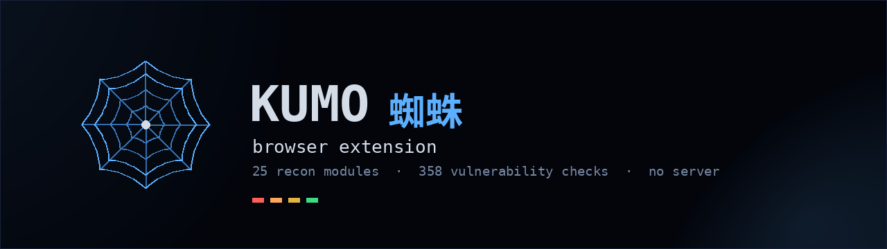
</p>

<p align="center">


<a href="https://demo-kumo-kage.vercel.app/"></a>
<a href="https://youtu.be/dM-KbBU93ZM"></a>
<a href="https://ko-fi.com/k0r1m"></a>
</p>

---

Open a site, click the icon, and Kumo maps everything reachable about that
domain: **DNS and email security**, **certificates and subdomains** from CT
logs, **open ports**, **technology fingerprints**, **leaked credentials**,
**cloud buckets**, and **420 vulnerability checks**. Twenty-seven modules run in
parallel, each streaming its own card the moment it lands.

It all happens inside your browser. **No server to start, no API key, no
account.**

This is the browser edition of
[**Kumo**](https://github.com/karim852/KUMO-Domain-Recon-Tool), the Python CLI
and dashboard. Same engine, same rules, same four themes.

<p align="center">
  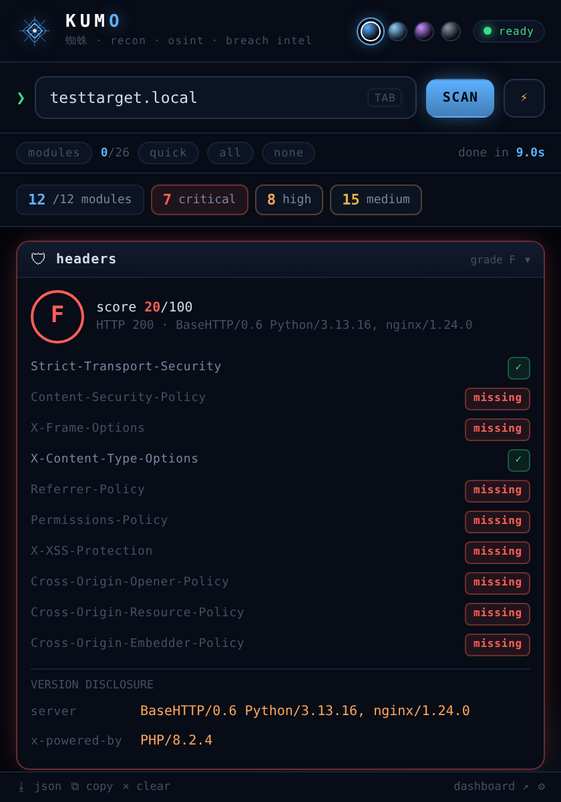
  <br><sub>Cards stream in as each module finishes, glowing by severity.
  Anything critical opens itself; quiet modules stay collapsed.</sub>
</p>

---

## 📑 Table of contents

- [Install](#-install)
- [Your first scan](#-your-first-scan)
- [Themes](#-themes)
- [Modules](#-modules)
- [Tests](#-tests)
- [What it never does](#-what-it-never-does)
- [Credits](#-credits)
- [Ecosystem](#-ecosystem)

---

## 📦 Install

### Requirements

| | |
|---|---|
| Browser | Chrome, Brave, Edge, Opera, Vivaldi, or Firefox |
| Python | only to build, or grab a release zip |
| Server | **none** |
| API keys | **none** |

### Build and load

```bash
git clone https://github.com/karim852/kumo-recon-browser-extension
cd kumo-recon-browser-extension
./build.sh
```

**Chrome, Brave, Edge, Opera, Vivaldi**
`chrome://extensions` → turn on **Developer mode** → **Load unpacked** →
pick `build/chrome`

**Firefox**
`about:debugging#/runtime/this-firefox` → **Load Temporary Add-on** →
pick `build/firefox/manifest.json`

Prebuilt zips are attached to every [release](../../releases).

---

## 🚀 Your first scan

Open any site you are allowed to test, then click the Kumo icon. The domain of
the tab is already in the box, subdomain included.

<p align="center">
  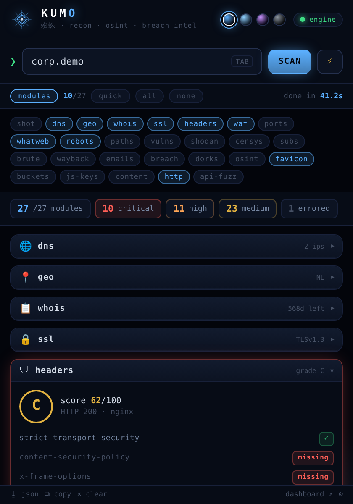
  <br><sub><b>quick</b> is a dozen fast modules. <b>all</b> runs everything.
  Your choice is remembered.</sub>
</p>

| | |
|---|---|
| **SCAN** | run the selected modules |
| **⚡** | fast mode, skips the slow modules |
| **TAB** | re-read the domain from the current tab |
| **⭳ json** | download the raw scan |
| **⧉ copy** | one line per module, for notes |
| right click | **Kumo: scan this site**, or a link's domain |
| `Alt+K` | open on the current tab |

Close the panel and the scan keeps going. Reopen it later and every card is
waiting. The toolbar badge counts modules while it runs, then turns red,
orange, yellow or green for the worst thing it found.

---

## 🎨 Themes

The same four palettes as the dashboard, switched from the dots in the header.

<p align="center">
  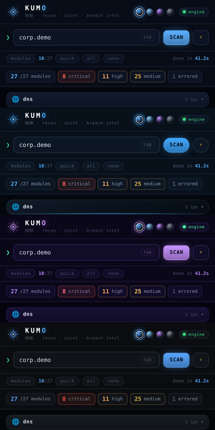
  <br><sub>Void · Void Glass · Web 蜘蛛 · Carbon. Carbon is the calm one for
  client screenshots.</sub>
</p>

---

## 🧩 Modules

**27 modules**, all running in parallel. Click any one to see what it returns.

### Network & Infrastructure

<details>
<summary><b>📡 DNS — records + email security</b> &nbsp;·&nbsp; <code>dns</code></summary>

Full DNS enumeration with a verdict on email protection. Flags missing DMARC,
weak SPF policies and absent DKIM.

<p align="center">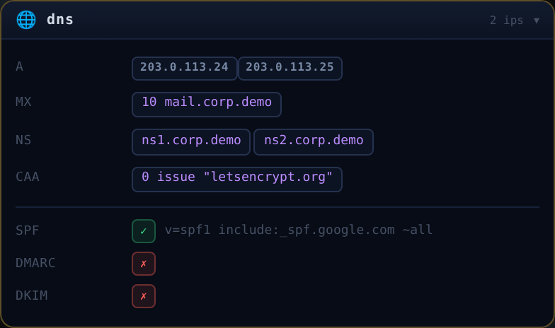</p>
</details>

<details>
<summary><b>📍 Geolocation — IP + ASN</b> &nbsp;·&nbsp; <code>geo</code></summary>

Resolves the domain, geolocates each IP, and pulls ASN, ISP and hosting status.

<p align="center">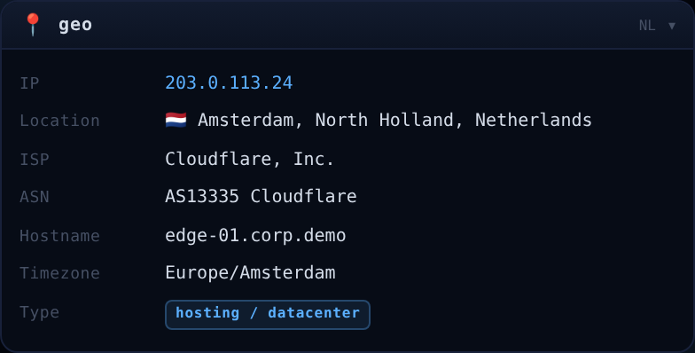</p>
</details>

<details>
<summary><b>📋 WHOIS — registration via RDAP</b> &nbsp;·&nbsp; <code>whois</code></summary>

Creation date, expiry, registrar and nameservers, resolved through the IANA
RDAP registry. Registries with no RDAP service say so plainly instead of
showing an error.

<p align="center">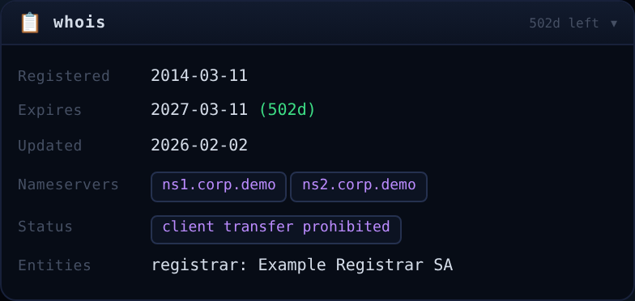</p>
</details>

<details>
<summary><b>🔒 Certificates — from CT logs</b> &nbsp;·&nbsp; <code>ssl</code></summary>

Issuer, validity, serial and every Subject Alternative Name, pulled from
Certificate Transparency. A browser cannot read a live cipher, so for the
negotiated protocol use the CLI.

<p align="center">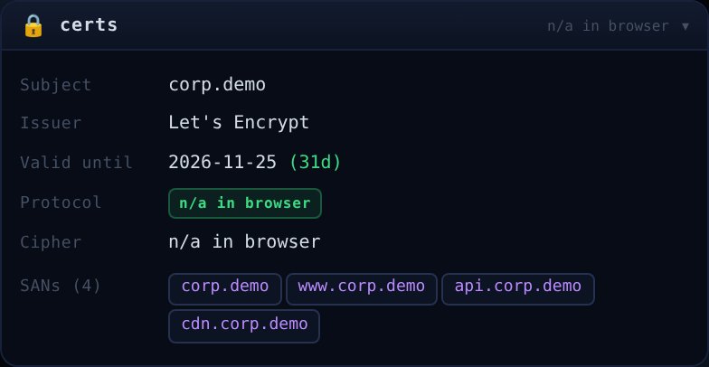</p>
</details>

<details>
<summary><b>🔌 Ports — observed, not scanned</b> &nbsp;·&nbsp; <code>ports</code></summary>

A browser has no TCP sockets, so this reports what **Shodan InternetDB** last
saw open, labelled with the CLI's own service and risk table. A port missing
here means *not seen*, never *closed*, and the card says so.

<p align="center">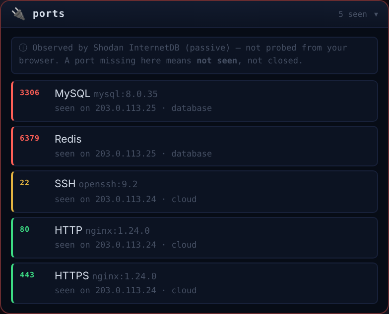</p>
</details>

<details>
<summary><b>🕸 Subdomains — CT log discovery</b> &nbsp;·&nbsp; <code>subdomains</code></summary>

Every hostname ever certified for the domain, resolved and flagged when the
name looks sensitive: vpn, staging, jenkins, internal.

<p align="center">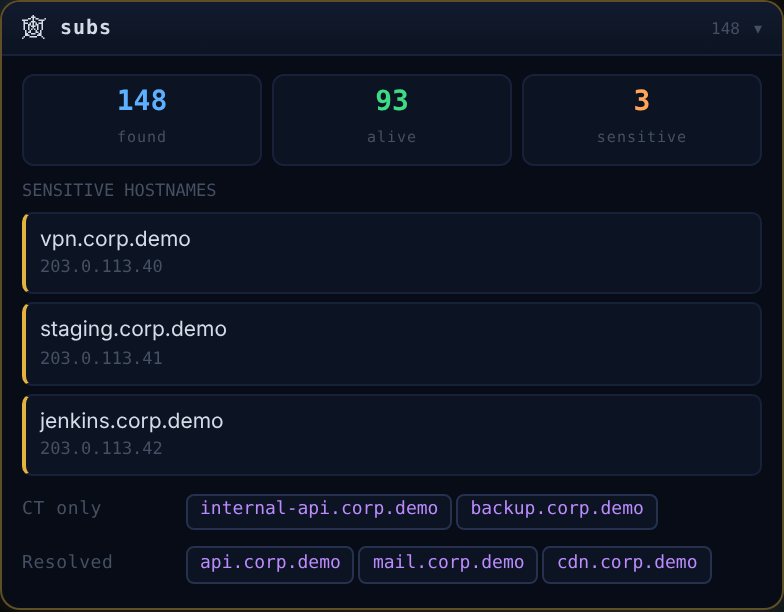</p>
</details>

<details>
<summary><b>🛰 Shodan — InternetDB + CVEs</b> &nbsp;·&nbsp; <code>shodan</code></summary>

Ports, tags and known CVEs per IP, coloured by CVSS band. Free and keyless.

<p align="center">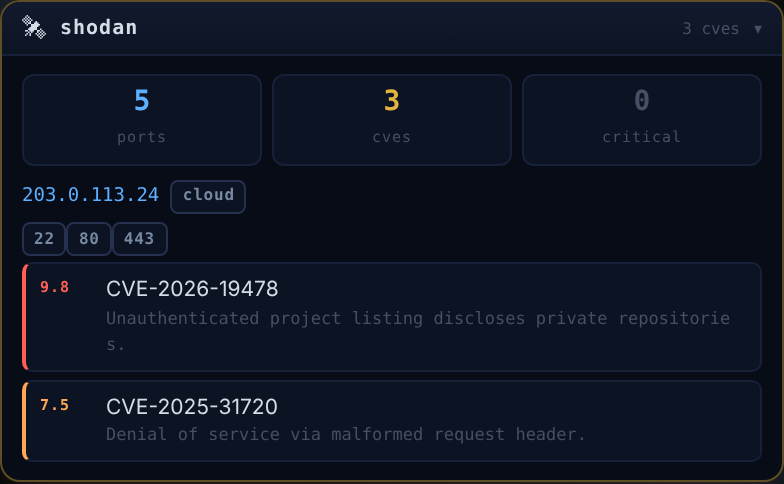</p>
</details>

### Web Surface

<details>
<summary><b>🛡 Security headers — graded</b> &nbsp;·&nbsp; <code>headers</code></summary>

Every security header checked and scored A to F, plus any version disclosure
the server volunteers.

<p align="center">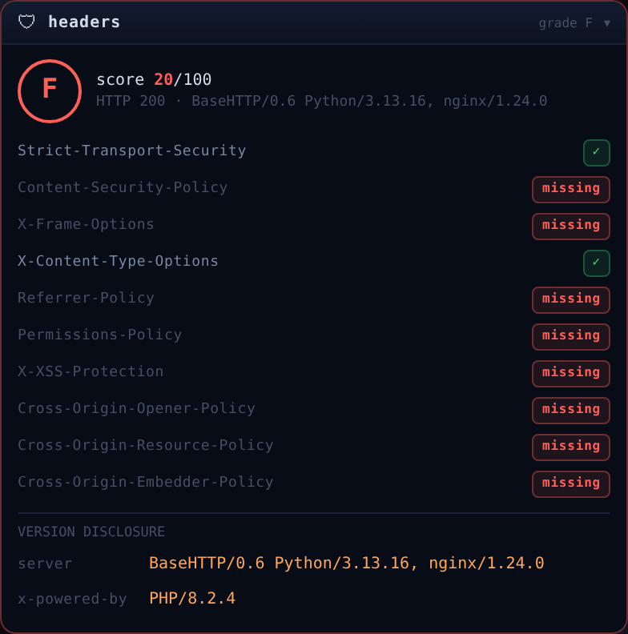</p>
</details>

<details>
<summary><b>🧬 Tech detection</b> &nbsp;·&nbsp; <code>whatweb</code></summary>

CMS, framework, language, CDN, analytics and versions, from headers and body.

<p align="center">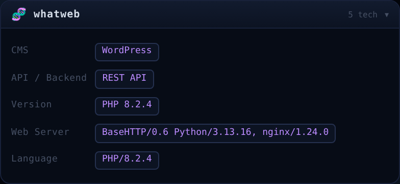</p>
</details>

<details>
<summary><b>🧱 WAF detection</b> &nbsp;·&nbsp; <code>wafw00f</code></summary>

Fingerprints 30 WAFs. Each signature is matched only against the part of the
response it belongs to, so a word in the page body never names a vendor.

<p align="center">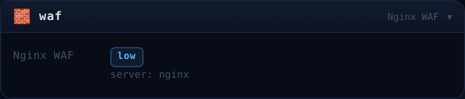</p>
</details>

<details>
<summary><b>📶 HTTP inspector</b> &nbsp;·&nbsp; <code>http_inspect</code></summary>

Final URL, allowed methods with dangerous ones flagged, cookie flags, and
leaky headers.

<p align="center">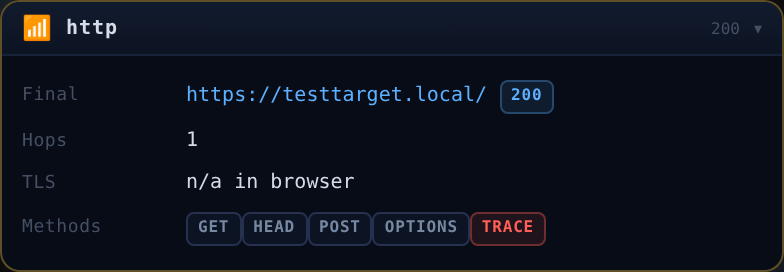</p>
</details>

<details>
<summary><b>🤖 Robots, sitemap, security.txt</b> &nbsp;·&nbsp; <code>robots</code></summary>

Disallowed paths with the sensitive ones highlighted, because what a site hides
is usually what is worth looking at.

<p align="center">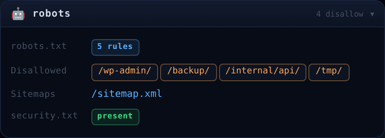</p>
</details>

<details>
<summary><b>🖼 Page identity</b> &nbsp;·&nbsp; <code>screenshot</code></summary>

Title, description, CMS and final URL.

<p align="center">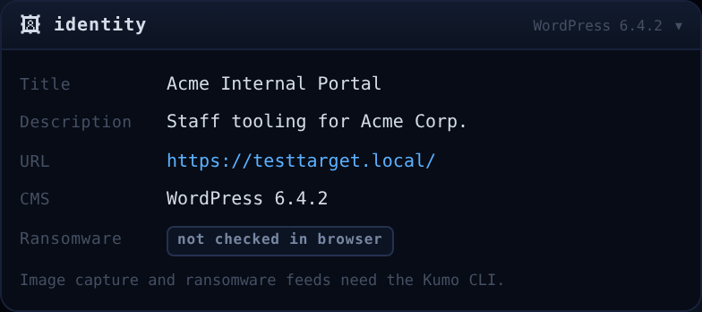</p>
</details>

<details>
<summary><b>🎯 Favicon hash</b> &nbsp;·&nbsp; <code>favicon</code></summary>

The mmh3 hash Shodan indexes, with ready-made Shodan and FOFA pivots to find
every other host running the same app.

<p align="center">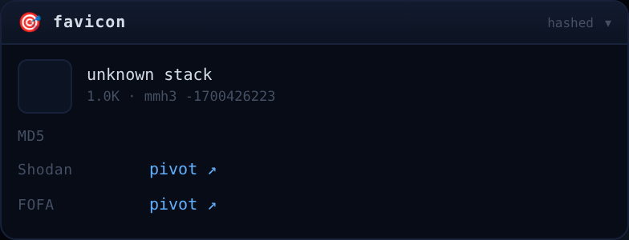</p>
</details>

### Exposure & Vulnerabilities

<details>
<summary><b>☣ Vulnerability scanner — 420 checks</b> &nbsp;·&nbsp; <code>nuclei</code></summary>

The full rule set from the CLI, matched in the browser. Findings are verified
against the site's own soft 404 before being reported, so a site that answers
200 for everything produces nothing.

<p align="center">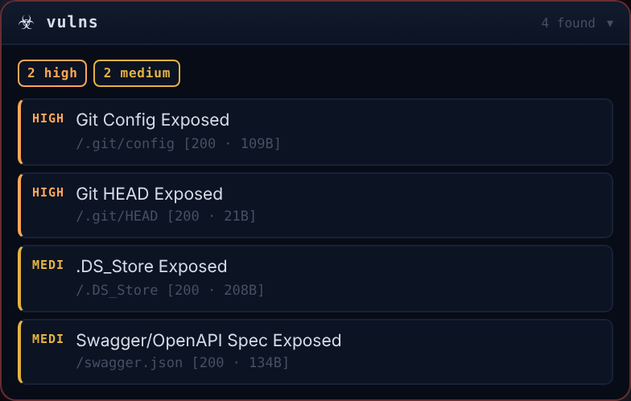</p>
</details>

<details>
<summary><b>📂 Sensitive endpoints — 142 paths</b> &nbsp;·&nbsp; <code>endpoints</code></summary>

Config files, backups, admin panels, dotfiles. Same soft 404 verification.

<p align="center">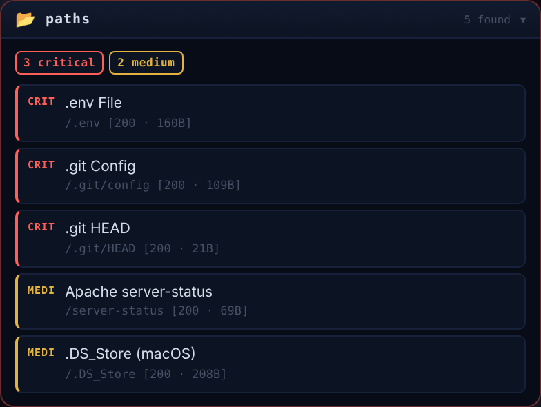</p>
</details>

<details>
<summary><b>🔑 JS secret scanner</b> &nbsp;·&nbsp; <code>js_secrets</code></summary>

69 patterns across every script the page loads: AWS keys, GitHub tokens,
Stripe keys, database URLs, hardcoded passwords. **Always redacted on screen.**

<p align="center">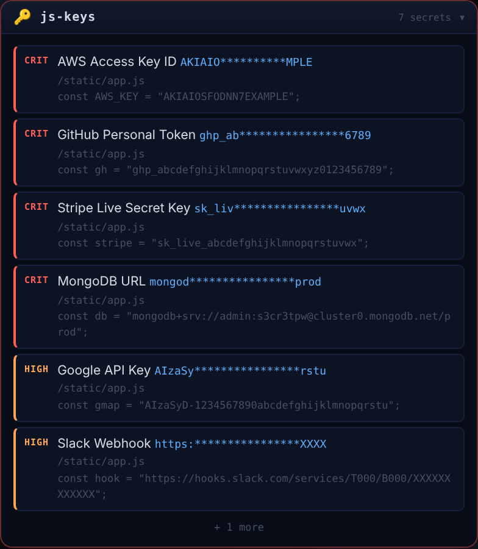</p>
</details>

<details>
<summary><b>⚙ API fuzzer</b> &nbsp;·&nbsp; <code>api_fuzzer</code></summary>

Finds API bases, Swagger and OpenAPI specs, and flags GraphQL endpoints with
introspection left on.

<p align="center">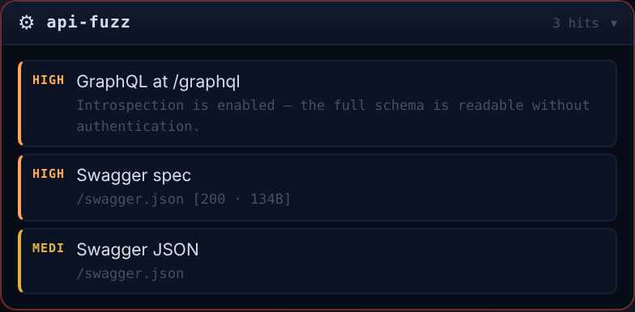</p>
</details>

<details>
<summary><b>🧱 CMS deep scan</b> &nbsp;·&nbsp; <code>cms</code></summary>

Identifies WordPress, Joomla or Drupal from 18 weighted structural signals —
asset paths, generator meta, headers — then runs only that platform's checks,
so a Drupal site is never probed for WordPress paths. Reads the version, probes
34 CMS-specific sensitive paths, and on WordPress enumerates users via the REST
API plus plugins and themes with versions.

Detection never matches a product name in page text, so a blog that writes
*about* WordPress is not reported as running it. Fingerprinting covers 20
platforms; anything without deep checks is named as such rather than returning
an empty card that would read as clean.

</details>

<details>
<summary><b>🎛 Hosting control panels</b> &nbsp;·&nbsp; <code>panels</code></summary>

cPanel, WHM, Plesk, DirectAdmin, Webmin, Virtualmin, CyberPanel, aaPanel,
Hestia, VestaCP, CentOS Web Panel, ISPConfig, Froxlor, Cockpit, Ajenti and more
— 17 panels across 20 ports.

**Passive first, like `ports`.** A page cannot open a TCP socket, and the panels
that answer on 2083, 8443 or 10000 almost always present a self-signed
certificate that `fetch()` refuses with no way to continue. So this asks Shodan
which panel ports are open, then confirms the login interface over HTTP where it
can. A port Shodan saw but the browser could not read is reported as exactly
that, never as a confirmed panel — and panels are matched by their interface,
not their name, so a hosting company's own site reports none of the products it
sells.

</details>

<details>
<summary><b>🪣 Cloud buckets</b> &nbsp;·&nbsp; <code>cloud_buckets</code></summary>

Hundreds of name permutations against S3, Google Cloud Storage and Azure Blob.

<p align="center">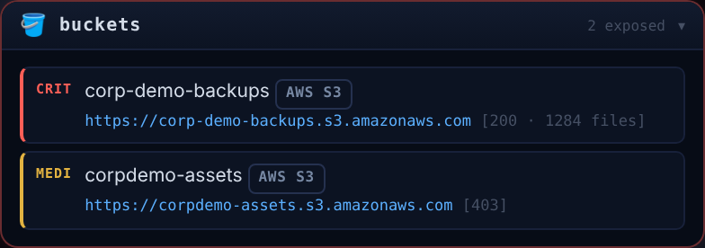</p>
</details>

<details>
<summary><b>🧠 Content intel</b> &nbsp;·&nbsp; <code>content_intel</code></summary>

Pulls internal hostnames, API routes, emails, cloud URLs and database strings
out of the JavaScript the site ships.

<p align="center">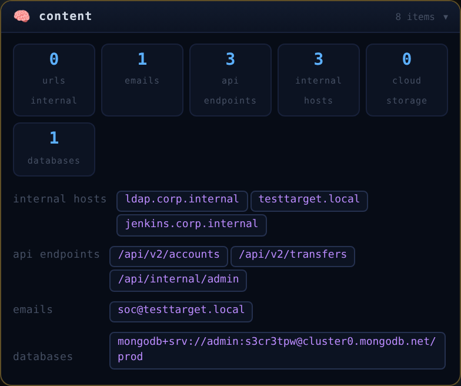</p>
</details>

### Intelligence

<details>
<summary><b>🩸 Breach intel</b> &nbsp;·&nbsp; <code>breachintel</code></summary>

Infostealer infections and leaked employee credentials, via Hudson Rock. Tells
you the difference between "nothing found" and "the lookup failed".

<p align="center">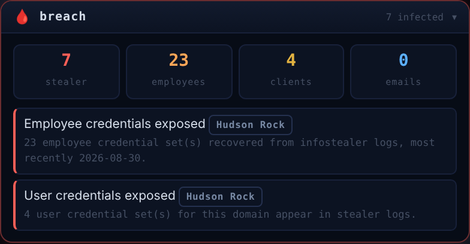</p>
</details>

<details>
<summary><b>🕰 Wayback archives</b> &nbsp;·&nbsp; <code>wayback</code></summary>

How far back the site goes, and the archived URLs worth a second look: backups,
debug pages, internal APIs.

<p align="center">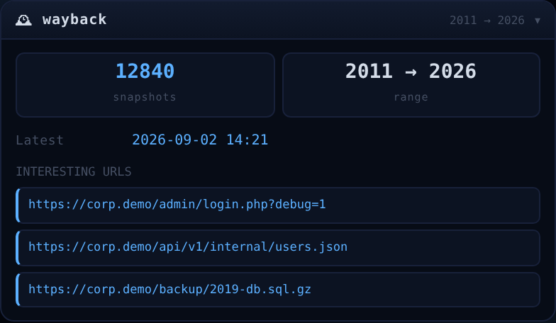</p>
</details>

<details>
<summary><b>✉ Email harvester</b> &nbsp;·&nbsp; <code>email_harvest</code></summary>

Addresses from the homepage, contact pages and archived URLs.

<p align="center">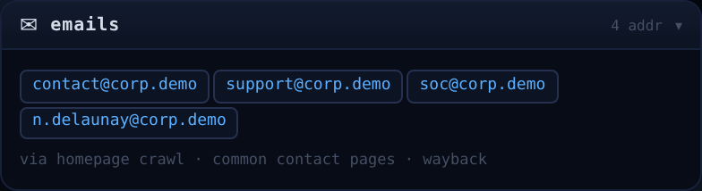</p>
</details>

<details>
<summary><b>📡 Censys pivots</b> &nbsp;·&nbsp; <code>censys</code></summary>

Certificates and host pivots. Also `brute` for subdomain brute forcing over
DNS-over-HTTPS.
</details>

---

## 🧪 Tests

```bash
./test/run_all.sh ../kumo-domain-recon-tool
```

The engine ships `engine.py`'s own rules and tables, generated by
`tools/build_tables.py` rather than retyped, so the risk is not a wrong table —
it is the two engines quietly disagreeing. Three of the four suites are parity
checks against the main repo, and they regenerate their cases from `engine.py`
before running:

| Suite | What it proves |
|---|---|
| `rule_parity.mjs` | all 420 rules reach engine.py's verdict, across a synthesised positive and six benign response shapes — 2,940 cases |
| `version_parity.mjs` | the `version` matcher agrees on every boundary, patched releases and unparseable input included |
| `fingerprint_parity.mjs` | no signature fires on a page that merely names the products, in body or headers |
| `render_smoke.mjs` | every card renders with real data, an error and an empty object, and none says the wrong thing |

If `engine.py`'s detection logic changes and the port is not updated, the parity
suites fail. That is the point of them.

---

## 🔐 What it never does

- **It never sends your cookies.** Every request goes out with credentials
  omitted. Probing `/admin` while you are logged in would be a self inflicted
  CSRF.
- **It never phones home.** There is no backend, no analytics and no account.
  Results live in the extension and nowhere else.
- **It never starts on its own.** The domain is pre-filled; nothing runs until
  you press SCAN.
- **It never shows a secret in full.** Found credentials are always redacted.

A full scan is a few hundred requests. The ⚙ page lets you lower the
concurrency and add a delay, so you can be gentle with a fragile target.

---

## 🙏 Credits

Built on top of [**Kumo**](https://github.com/karim852/KUMO-Domain-Recon-Tool)
by [**k0r1m**](https://github.com/karim852). The rules, wordlists and
signatures in this extension are generated from that project's engine, so the
two stay in step. **If you find this useful, star the main repo.**

Kumo collects and correlates. The data belongs to the sources below, and they
deserve the credit far more than this repo does:

| Source | Used for |
|---|---|
| [crt.sh](https://crt.sh) | certificate transparency logs, subdomain discovery |
| [Shodan InternetDB](https://internetdb.shodan.io) | open ports, CVEs, host tags, free and keyless |
| [Hudson Rock](https://hudsonrock.com) | infostealer infection intelligence |
| [ProjectDiscovery](https://github.com/projectdiscovery/nuclei-templates) | the templates behind most vulnerability rules |
| [Wayback Machine](https://web.archive.org) | archived URLs and historical surface |
| [IANA RDAP](https://data.iana.org/rdap/dns.json) | authoritative registration data |
| [Cloudflare](https://cloudflare-dns.com) & [Google](https://dns.google) | DNS over HTTPS |

Respect each source's own terms of use and rate limits.

---

## 🌐 Ecosystem

| | Tool | Domain |
|---|---|---|
| ☁️ | [**Kumo** 蜘蛛](https://github.com/karim852/KUMO-Domain-Recon-Tool) | domain OSINT & reconnaissance, CLI + dashboard &nbsp;·&nbsp; [demo](https://youtu.be/dM-KbBU93ZM) |
| 🧩 | **Kumo browser extension** | the same engine, in your browser |
| 🌍 | [**Demo site**](https://demo-kumo-kage.vercel.app/) | Kumo & Kage showcase |
| 🌑 | [**Kage** 影](https://github.com/karim852/Kage-DFIR-toolkit) | DFIR host triage |

---

> ⚠️ **For authorized security testing only.**
> Only scan domains you own or have explicit written permission to test.
> Free to use, modify and share for educational and personal purposes. Please
> credit the work. Commercial use requires explicit permission from the author.

<p align="center"><sub>Built for those who move fast. 蜘蛛</sub></p>
